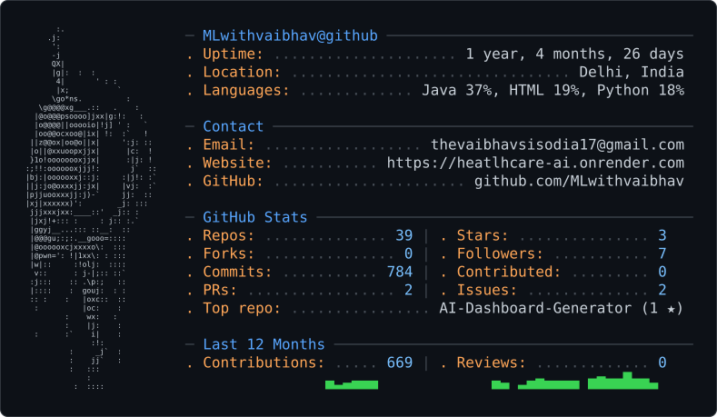

<div align="center">

```text
██╗   ██╗ █████╗ ██╗██████╗ ██╗  ██╗ █████╗ ██╗   ██╗    
██║   ██║██╔══██╗██║██╔══██╗██║  ██║██╔══██╗██║   ██║    
██║   ██║███████║██║██████╔╝███████║███████║██║   ██║    
╚██╗ ██╔╝██╔══██║██║██╔══██╗██╔══██║██╔══██║╚██╗ ██╔╝    
 ╚████╔╝ ██║  ██║██║██████╔╝██║  ██║██║  ██║ ╚████╔╝     
  ╚═══╝  ╚═╝  ╚═╝╚═╝╚═════╝ ╚═╝  ╚═╝╚═╝  ╚═╝  ╚═══╝      
                                                         
                  S I S O D I A
```

### `software_developer.exe`

**JAVA Developer · Backend Engineer · Systems Builder**

<br/>

<picture>
  <source media="(prefers-color-scheme: dark)" srcset="dark_mode.svg" />
  <source media="(prefers-color-scheme: light)" srcset="light_mode.svg" />
  
</picture>

<br/>

[](https://backend-portfolio-rho-ten.vercel.app/
)
[](https://linkedin.com/in/vaibhav-v-705280320)
[](https://leetcode.com/u/systemswithvaibhav/)

</div>

---

```bash
$ whoami
```

```text
Vaibhav Sisodia

Software Developer building reliable backend systems and modern web apps.
Core stack: Java • Spring Boot • Next.js • PostgreSQL.

Focused on writing clean code, solving algorithmic challenges, and 
engineering systems built to scale.
```

---

```bash
$ cat ./identity.json
```

```json
{
  "name": "Vaibhav Sisodia",
  "role": [
    "Backend Engineer",
    "Systems Builder",
    "Java Developer"
  ],
  "interests": [
    "High-Performance APIs",
    "Microservices Architecture",
    "Relational Databases",
    "Data Structures & Algorithms"
  ],
  "mindset": "Code simply, design for scale, optimize when measured."
}
```

---

```bash
$ ./tech-stack
```

<table>
<tr>
<td valign="top" width="33%">

### `LANGUAGES`

```text
Java (Core & OOP)
SQL
Bash / Shell
C
Python
```

</td>

<td valign="top" width="33%">

### `FRONTEND`

```text
Next.js
HTML
CSS
```

</td>

<td valign="top" width="33%">

### `BACKEND`

```text
Spring Boot
Spring MVC
RESTful APIs
JWT & Security
Microservices
FLASK
```

</td>
</tr>

<tr>
<td valign="top">

### `DATABASES`

```text
MySQL
PostgreSQL
Database Indexing
```

</td>

<td valign="top">

### `INFRASTRUCTURE`

```text
Docker
Linux
Git
GitHub
```

</td>

<td valign="top">

### `TOOLS`

```text
IntelliJ IDEA
Maven
VS Code
Postman
NPM
Vite
```

</td>
</tr>
</table>

---

```bash
$ ls ./projects
```

### `01` — HEALTHCARE AI

```text
┌─────────────────────────────────────────────────────────────┐
│                                                             │
│  HEALTH AI ASSISTANT                                        │
│                                                             │
│  AI-powered healthcare platform & vitals analytics tracker  │
│                                                             │
│  Full-stack medical assistant with Google Gemini AI symptom │
│  analysis, session auth, and real-time Chart.js telemetry.  │
│                                                             │
│  Python • Flask • Gemini API • SQLAlchemy • SQLite • Charts │
│                                                             │
│  [ VIEW PROJECT → ]                                         │
│                                                             │
└─────────────────────────────────────────────────────────────┘
```

[](https://github.com/systemswithvaibhav/Heatlhcare-AI)


### `02` — VC-SCOUT

```text
┌─────────────────────────────────────────────────────────────┐
│                                                             │
│  VC SCOUT                                                   │
│                                                             │
│  Startup discovery & venture opportunity analysis platform  │
│                                                             │
│  Scans GitHub signals and market feeds to evaluate startup  │
│  traction, risk, and unicorn potential using Google Gemini. │
│                                                             │
│  Next.js • Flask • Gemini API • GitHub API • Tailwind CSS   │
│                                                             │
│  [ VIEW PROJECT → ]                                         │
│                                                             │
└─────────────────────────────────────────────────────────────┘
```

[](https://github.com/systemswithvaibhav/VC-Scout)


### `03` — MULTI-THREADED HTTP SERVER

```text
┌─────────────────────────────────────────────────────────────┐
│                                                             │
│  MULTI-THREADED HTTP SERVER                                 │
│                                                             │
│  Lightweight concurrent HTTP server built from scratch      │
│                                                             │
│  Custom TCP socket architecture supporting multi-threaded   │
│  request handling, bench-tested on 60k requests via JMeter. │
│                                                             │
│  Java • Socket Programming • Multithreading • TCP • JMeter  │
│                                                             │
│  [ VIEW PROJECT → ]                                         │
│                                                             │
└─────────────────────────────────────────────────────────────┘
```

[](https://github.com/systemswithvaibhav/WEB-SERVER-JAVA-)


```

---

```bash
$ ./problem-solving
```

<div align="center">

### `DATA STRUCTURES & ALGORITHMS`

<br/>


<br/><br/>

`Arrays` · `Strings` · `Hashing` · `Two Pointers` · `Stack` · `Queue`

`Binary Search` · `Trees` · `Recursion` · `Dynamic Programming` · `Graphs`

</div>

---

```bash
$ ./github
```


<div align="center">

<table>
<tr>
<td width="50%" align="center">


</td>

<td width="50%" align="center">


</td>
</tr>
</table>

<br/><br/>


</div>

---


<div align="center">

```text
╔════════════════════════════════════════════════════╗
║                                                    ║
║       "Don't just write code.                      ║
║        Understand the system behind it."           ║
║                                                    ║
╚════════════════════════════════════════════════════╝
```

### `BUILD → BREAK → DEBUG → LEARN → REBUILD`

<br/>

[](https://github.com/systemswithvaibhav)
<br/><br/>

`Thanks for visiting my profile.`

**—Vaibhav Sisodia**

</div>
